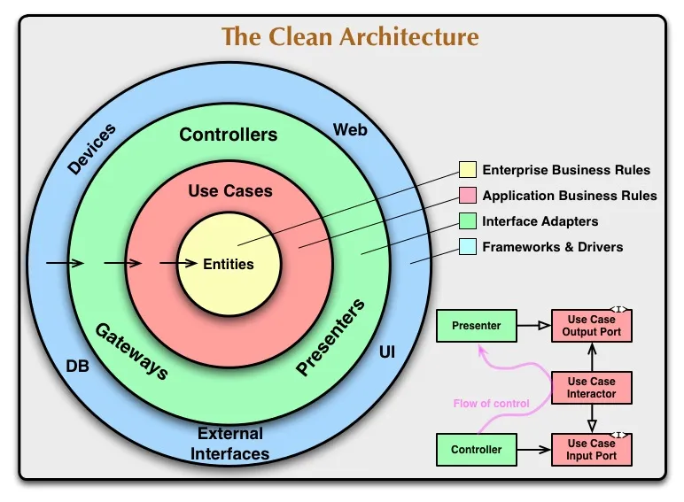

# About the Project

This project aims to study and apply (using Python) concepts related to **Clean Architecture**.

It was based on several tutorials and digital content, all referenced at the end of this document.

<hr>

# Requirements to Run the Tests

* Python (tested with version 3.10)
* Pytest (version specified in the `requirements.txt` file)

Tips:

* Create a virtual environment to run everything in isolation:

  ```bash
  $ pip3 install virtualenv

  $ virtualenv -p python3 .venv

  $ source .venv/bin/activate
  ```

* Run the tests:

  ```bash
  $ make test
  ```

* Generate an updated MER:

  ```bash
  $ make mer
  ```

<hr>

# Clean Architecture Basics



Clean Architecture mainly aims at separating business rules from everything external to them.
In theory, applying a Clean Architecture model should ensure:

* framework independence
* user interface independence
* database independence
* independence from any external elements
* testability

## Pros

* Separation and encapsulation of business rules.

  * This can be related to the **“S” in SOLID**, since we are, in a way, applying the **Single Responsibility Principle** in the architectural context.

* Business rules can be tested without the need for user interfaces, and this should guide us, because an access interface can change (e.g., before via web, now via console).

* Easier database switching, since no specific library is explicitly tied to the definition of business rules.

* Business rules do not “see” the outside world. With this, we achieve a **front-up view**.

## Cons

* Requires an understanding of the business domain and its rules to define the application core.
* Has greater initial complexity in implementation.

## Entities (Domain)

This is where all the business rules of the application are defined.

For example, in a **to-do list application**, we could have the following entities and rules:

* **Entity Item**, containing:

  * title (longer than 3 letters)
  * description (optional)
  * priority (from 1 to 3)

* **Entity List**, containing:

  * owner
  * items (list of Item)

## Use Case

In this section, we define some usage flows of the application.
Here we place business rules at the **application layer**. These rules do not change the entities’ rules but use them.

In a **to-do list application**, the use cases could be:

* Create a task list
* Add an item to a previously created list
* Complete a task list

## Interface Adapters — Controllers, Gateways, Presenters (communication)

This layer may include anything from serializers to repositories for database interaction.
In this case, let’s use as an example a **Persistence Gateway** (not tied to any specific database):

* **Persistence Gateway**:

  * will be an interface
  * will have three methods:

    * store Item
    * delete Item
    * list all Items in a List

This way, regardless of the implementation (Postgres, SQLite, or even in-memory storage with Redis cache),
we will have this gateway defining the desired interactions.

---

# References

* [https://medium.com/luizalabs/descomplicando-a-clean-architecture-cf4dfc4a1ac6](https://medium.com/luizalabs/descomplicando-a-clean-architecture-cf4dfc4a1ac6)
* [https://www.alura.com.br/artigos/mer-e-der-funcoes](https://www.alura.com.br/artigos/mer-e-der-funcoes)
* [https://noplacelikelocalhost.medium.com/testing-crud-operations-with-sqlite-a-time-saving-guide-for-developers-7c74405d63d5](https://noplacelikelocalhost.medium.com/testing-crud-operations-with-sqlite-a-time-saving-guide-for-developers-7c74405d63d5)
* [https://docs.sqlalchemy.org/en/20/orm/quickstart.html](https://docs.sqlalchemy.org/en/20/orm/quickstart.html)
* [https://fastapi.tiangolo.com/tutorial/sql-databases/](https://fastapi.tiangolo.com/tutorial/sql-databases/)
* [https://macoratti.net/21/10/net\_cleanarch1.htm](https://macoratti.net/21/10/net_cleanarch1.htm)

---

